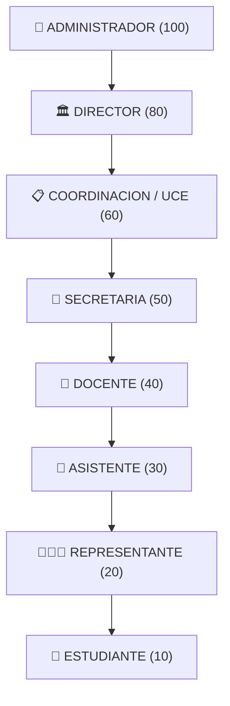
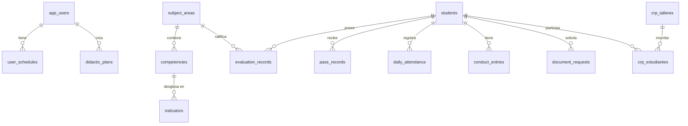

# 🏛️ SICE-CBA — Estructura Integral del Sistema y Funciones
**Sistema Integral de Control y Evaluación • U.E.P. Colegio Bellas Artes**  
*Maracaibo, Estado Zulia, Venezuela • Año Escolar: 2026 - 2027*  
*Autor: Ing. en Informática Miguelangel Contreras Guillén*

---

## 📑 Tabla de Contenidos
1. [Visión General del Sistema](#1-visión-general-del-sistema)
2. [Arquitectura Tecnológica y de Red](#2-arquitectura-tecnológica-y-de-red)
3. [Estructura de Carpetas del Proyecto](#3-estructura-de-carpetas-del-proyecto)
4. [Subsistemas Educativos y Escalas Evaluativas](#4-subsistemas-educativos-y-escalas-evaluativas)
5. [Matriz de Roles y Permisos (RBAC)](#5-matriz-de-roles-y-permisos-rbac)
6. [Módulos del Sistema y sus Funciones Detalladas](#6-módulos-del-sistema-y-sus-funciones-detalladas)
   - [6.1 Escritorio (Dashboard)](#61-escritorio-dashboard)
   - [6.2 Gestión Operativa y Control de Estudios](#62-gestión-operativa-y-control-de-estudios)
   - [6.3 Módulos Académicos de Nivel (Inicial, Primaria, Media General)](#63-módulos-académicos-de-nivel-inicial-primaria-media-general)
     - [A. Pilar de Planificación Didáctica](#a-pilar-de-planificación-didáctica)
     - [B. Pilar de Evaluación del Aprendizaje](#b-pilar-de-evaluación-del-aprendizaje)
     - [C. Pilar de Comunicación Académica](#c-pilar-de-comunicación-académica)
   - [6.4 Consultas](#64-consultas)
   - [6.5 Comunidad Escolar](#65-comunidad-escolar)
   - [6.6 Configuración del Sistema](#66-configuración-del-sistema)
   - [6.7 Centro de Inducción, Ayuda y Soporte](#67-centro-de-inducción-ayuda-y-soporte)
   - [6.8 Componentes Transversales y de Productividad](#68-componentes-transversales-y-de-productividad)
7. [Modelo de Datos y Base de Datos PostgreSQL](#7-modelo-de-datos-y-base-de-datos-postgresql)
8. [Flujo de Procesos Clave](#8-flujo-de-procesos-clave)

---

## 1. Visión General del Sistema

**SICE-CBA** es una plataforma institucional integral desarrollada a la medida para la **Unidad Educativa Privada Colegio Bellas Artes (CBA)**. Su objetivo es centralizar, estandarizar y automatizar todos los procesos académicos, administrativos, pedagógicos y de control de estudios de la institución, cubriendo sus tres subsistemas de enseñanza: **Educación Inicial**, **Educación Primaria** y **Educación Media General**.

El sistema garantiza un estricto cumplimiento del marco normativo del Ministerio del Poder Popular para la Educación (MPPE) de Venezuela y las directrices internas de la Unidad de Control de Estudios (UCE) del Colegio Bellas Artes.

---

## 2. Arquitectura Tecnológica y de Red

```mermaid
flowchart TD
    subgraph Clientes ["Dispositivos Clientes"]
        PC1["PC Docente / Administrativo (LAN)"]
        TAB["Tablet / Laptop de Aula"]
        MOBI["Móvil / Portería"]
    end

    subgraph ServidorLocal ["Servidor Local On-Premise CBA"]
        VITE["Servidor Frontend (Vite)
Puerto 3000"]
        API["API REST Nativa Node.js
Puerto 54321 (tools/api-server.mjs)"]
        PG[("PostgreSQL 16 Nativo
Puerto 5432 (DB: sisceba)")]
    end

    PC1 -->|HTTP / LAN| VITE
    TAB -->|HTTP / LAN| VITE
    MOBI -->|HTTP / LAN| VITE

    VITE -->|React 19 / State Management| API
    API -->|pg.Pool (50 conexiones máx)| PG
```

### Características Técnicas
- **Frontend**: React 19, TypeScript, Vite 8, Tailwind CSS 3, Lucide React (iconografía), Recharts (analítica visual).
- **Backend**: API REST nativa en Node.js (`tools/api-server.mjs`) en el puerto `54321`, con soporte CORS y pool de conexiones de alto desempeño.
- **Base de Datos**: PostgreSQL 16 nativo local (puerto `5432`, base de datos `sisceba`). No depende de servicios externos ni de nube obligatoria (cero dependencias de Supabase en producción local).
- **Red Local Institucional (LAN)**: Accesible simultáneamente desde cualquier equipo conectado a la red local del colegio mediante la IP institucional (`http://172.16.7.81:3000/SISCEBA/`) o de manera local (`http://localhost:3000`).
- **Resiliencia Offline**: Caché reactivo local que permite operar en contingencias de red y sincronizar al reanudar conexión.

---

## 3. Estructura de Carpetas del Proyecto

```
SIS-CBA/
├── .agents/                 # Habilidades y automatizaciones de agentes de desarrollo
├── .local_db/               # Motor binario y datos locales de PostgreSQL 16
├── docs/                    # Documentación formal institucional y capítulos de tesis/proyecto
│   ├── CAPITULO_I_INFORMACION_GENERAL_CBA.md
│   ├── CAPITULO_II_PLANIFICACION_ACTIVIDADES_CBA.md
│   └── CAPITULO_III_DESARROLLO_ACTIVIDADES_CBA.md
├── public/                  # Activos estáticos públicos (logos, favicon)
├── src/                     # Código fuente de la aplicación
│   ├── assets/              # Logos e imágenes institucionales
│   ├── components/          # Componentes modulares de interfaz organizados por dominio
│   │   ├── auth/            # Vistas de autenticación (Login, Auto-registro, Reseteo)
│   │   ├── ayuda/           # Manual de usuario interactivo y mapa del sitio
│   │   ├── common/          # Componentes reusables (indicador de contraseña, toasts)
│   │   ├── communication/   # Boletines, actas de consejo, planes remediales e IA
│   │   ├── comunidad/       # Cartelera de noticias, comunicados y cumpleaños
│   │   ├── configuracion/   # Lapsos, mallas, configuración CEO y temas visuales
│   │   ├── consultas/       # Rendimiento, boletines, nóminas y analítica
│   │   ├── dashboard/       # Escritorio principal, perfil, horarios y buzón
│   │   ├── dev/             # HUD de desarrollo (simulación de roles, métricas)
│   │   ├── evaluation/      # Diagnóstica, cuaderno procesal, cierre de lapso
│   │   ├── gestion/         # Inscripciones, pases, inasistencias, conductas, títulos, etc.
│   │   ├── layout/          # Encabezados, barras laterales, navegación móvil y dock
│   │   ├── notifications/   # Centro de notificaciones emergente
│   │   └── planning/        # Diseñador didáctico, bancos de competencias, recursos
│   ├── context/             # Estados globales de la aplicación
│   │   ├── AppContext.tsx   # Contexto principal de datos escolares y operaciones CRUD
│   │   └── ThemeContext.tsx # Contexto de temas visuales y personalización
│   ├── data/                # Semillas de datos, mallas iniciales y directrices CEO
│   │   ├── didacticPlanTemplates.ts
│   │   ├── privilegiosCEO.json
│   │   ├── seedData.ts
│   │   └── userManualRoleGuides.ts
│   ├── hooks/               # Custom hooks de React (useDevice, useKeyboardShortcuts)
│   ├── lib/                 # Clientes de base de datos (dbClient, supabaseClient fallback)
│   ├── services/            # Servicios de persistencia y comunicación con API
│   ├── types/               # Definiciones completas de TypeScript e interfaces del sistema
│   └── utils/               # Funciones utilitarias (RBAC, seguridad, validaciones)
├── tools/                   # Scripts de gestión de backend, migraciones y servidor
│   ├── api-server.mjs       # Servidor API REST PostgreSQL en Node.js
│   ├── db-runner.mjs        # Gestor de arranque del daemon PostgreSQL
│   ├── db-stop.mjs          # Script de apagado seguro de la base de datos
│   └── init-db.mjs          # Inicializador y ejecutor de DDL en PostgreSQL
├── INICIAR_SICEBA.bat       # Lanzador automático integral de entorno
├── DETENER_SICEBA.bat       # Detención segura de todos los servicios
├── package.json             # Metadatos del proyecto y dependencias npm
└── vite.config.ts           # Configuración de compilación y empaquetado Vite
```

---

## 4. Subsistemas Educativos y Escalas Evaluativas

Por lineamiento oficial e institucional del Colegio Bellas Artes, el sistema implementa tres subsistemas con reglas independientes y segregadas:

| Subsistema Educativo | Grados / Años Oficiales | Secciones | Escala de Evaluación Oficial | Reglas de Promoción y Cálculo |
|---|---|---|---|---|
| **Educación Inicial** | Sala de 3 Años, Sala de 4 Años, Sala de 5 Años | Exclusivamente **A** y **B** | **Literal** (`A`, `B`, `C`, `D`, `E`) | Evaluación formativa y cualitativa. **Prohibido el uso de promedios numéricos o escalas sobre 20**. Rutina diaria y espacios de aprendizaje. |
| **Educación Primaria** | 1er Grado a 6to Grado | Exclusivamente **A** y **B** | **Cualitativa / Formativa** (`L` [Logrado], `P` / `EP` [En Proceso], `I` [Iniciado]) | Proyectos de Aprendizaje (PA), ejes integradores y competencias de grado. No se emiten calificaciones cuantitativas vigesimales. |
| **Educación Media General**| 1er Año a 5to Año | Exclusivamente **A** y **B** | **Cuantitativa Vigesimal** (`01` a `20`) | Ponderaciones porcentuales acumulativas por lapso (100%), nota mínima aprobatoria 10/20, seguimiento de inasistencias del 25% y actas de consejo. |

---

## 5. Matriz de Roles y Permisos (RBAC)

El sistema opera bajo un modelo de control de acceso basado en roles con una jerarquía de privilegios de 9 niveles:



### Tabla de Responsabilidades y Acceso Modular

| Rol Institucional | Nivel | Alcance Funcional Principal | Pestañas con Acceso Permitido |
|---|---|---|---|
| **ADMINISTRADOR** | 100 | Control total del sistema, infraestructura, mantenimiento de base de datos, gestión de usuarios institucionales, emisión de códigos de registro y **Matrícula y Prosecución Escolar exclusiva**. | Todas: `ESCRITORIO`, `GESTION`, `INICIAL`, `PRIMARIA`, `MEDIA_GENERAL`, `CONSULTAS`, `COMUNIDAD`, `CONFIGURACION`, `AYUDA`. |
| **DIRECTOR** | 80 | Máxima autoridad ejecutiva. Firma de títulos de bachiller, aprobación y publicación de boletines informativos, bloqueo administrativo, reportes institucionales de cierre y circulares. | `ESCRITORIO`, `GESTION`, `INICIAL`, `PRIMARIA`, `MEDIA_GENERAL`, `CONSULTAS`, `COMUNIDAD`, `CONFIGURACION`, `AYUDA`. *(Sin acceso a Matrícula).* |
| **COORDINACION** | 60 | Unidad de Control de Estudios (UCE). Supervisión pedagógica, revisión y aprobación de planes quincenales, cuadernos procesales, actas de consejo de docentes, títulos y talleres CRP. | `ESCRITORIO`, `GESTION`, `INICIAL`, `PRIMARIA`, `MEDIA_GENERAL`, `CONSULTAS`, `COMUNIDAD`, `CONFIGURACION`, `AYUDA`. *(Sin acceso a Matrícula ni Bloqueo).* |
| **SECRETARIA** | 50 | Secretaría Académica / UCE. Admisiones, proceso de inscripciones en 3 pasos, padrón estudiantil, expedientes, solicitud y emisión de documentos (constancias de estudio, buena conducta) y nóminas. | `ESCRITORIO`, `GESTION` (Inscripciones, Documentos, Talleres CRP), `CONSULTAS`, `COMUNIDAD`, `AYUDA`. |
| **DOCENTE** | 40 | Cuerpo docente. Planificación didáctica oficial (diseñador, planes quincenales y de lapso), carga de calificaciones procesales y diagnósticas, asistencia diaria de aula, pases, conductas y talleres CRP. | `ESCRITORIO`, `GESTION` (Pases, Inasistencias, Conductas, Talleres CRP), Subsistemas asignados (`INICIAL`, `PRIMARIA`, `MEDIA_GENERAL`), `CONSULTAS`, `COMUNIDAD`, `CONFIGURACION` (Temas), `AYUDA`. |
| **ASISTENTE** | 30 | Asistente de Aula y Disciplina. Enfoque exclusivo en registro de asistencia diaria de estudiantes, pases de retraso en portería e historial de incidencias y disciplina escolar. **Sin carga de notas**. | `ESCRITORIO`, `GESTION` (Pases, Inasistencias, Conductas), `CONSULTAS` (Asistencia, Nóminas), `COMUNIDAD`, `AYUDA`. |
| **REPRESENTANTE** | 20 | Portal familiar: consulta exclusiva del expediente, boletines informativos por lapso, récord de asistencia y comunicados institucionales de su representado. | `CONSULTAS` (Rendimiento, Boletín, Asistencia), `COMUNIDAD` (Noticias, Comunicados), `AYUDA`. |
| **ESTUDIANTE** | 10 | Portal estudiantil: consulta personal de calificaciones procesales, boletines de lapso, asistencia personal y cartelera institucional. | `CONSULTAS` (Rendimiento, Boletín, Asistencia), `COMUNIDAD` (Noticias, Comunicados), `AYUDA`. |

---

## 6. Módulos del Sistema y sus Funciones Detalladas

### 6.1 Escritorio (Dashboard)
- **`DASHBOARD`**: Tablero central interactivo con métricas en vivo (matrícula activa, porcentaje de asistencia promedio, solicitudes de trámites pendientes, cumpleaños de la semana, anuncios destacados y accesos directos por rol).
- **`PERFIL`**: Gestión del perfil del usuario, actualización de correo, biografía, teléfono, carga de foto o selección de avatares oficiales institucionales, cambio de contraseña con medidor de robustez y configuración de autenticación de dos factores (2FA / TOTP).
- **`HORARIO`**: Visualización gráfica del horario académico semanal del docente o del estudiante con bloques de clases, asignaturas, grados, secciones y aulas asignadas.
- **`SUGERENCIAS`**: Canal formal para enviar observaciones pedagógicas, sugerencias institucionales o reportes de fallas técnicas al equipo directivo o administrativo.

---

### 6.2 Gestión Operativa y Control de Estudios (`GESTION`)
1. **`INSCRIPCIONES`**:
   - Asistente guiado (Wizard) en 3 pasos:
     1. Datos del Estudiante (nombres, cédula escolar/nacional, fecha de nacimiento, procedencia, diagnóstico médico).
     2. Datos del Representante Legal (cédula, parentesco, profesión, contactos de emergencia).
     3. Asignación Académica (selección del subsistema, grado o año y sección oficial: `A` o `B`).
2. **`PASES` (Pases por Retraso)**:
   - Registro de llegadas tardías en portería con hora exacta, motivo justificado/injustificado y emisor del pase.
   - Generación de comprobante imprimible con código QR de verificación para el ingreso al aula.
3. **`INASISTENCIAS`**:
   - Registro operativo de inasistencias por fecha y bloque horario.
   - Cálculo del porcentaje acumulado por materia y **alerta automática del 25% de inasistencias** (artículo 109 de la Ley Orgánica de Educación).
4. **`CONDUCTAS`**:
   - Registro y expediente de convivencia escolar, faltas leves, graves y gravísimas.
   - Asignación de medidas formativas, citaciones a representantes y compromisos firmados.
5. **`DOCUMENTOS` (Trámites y Constancias)**:
   - Solicitud, seguimiento y emisión digitalizada de documentos:
     - Constancia de Estudio.
     - Constancia de Buena Conducta.
     - Certificación de Calificaciones.
     - Constancia de Inscripción.
   - Control de SLA (tiempos de respuesta), estados (Pendiente, En Proceso, Listo para Entrega) e impresión oficial con membrete y sello CBA.
6. **`BLOQUEO` (Bloqueo Administrativo)**:
   - Gestión de solvencias y retención administrativa por cobranza o morosidad.
   - Bloquea la descarga de boletines informativos oficiales pero preserva el derecho del alumno a asistir a clases y ser evaluado.
7. **`TITULOS` (Títulos de Bachiller)**:
   - Submódulo de 5to año de Media General: validación de expediente de 1ro a 5to año, serial de papel moneda de título, registro de timbres fiscales y generación de la nómina oficial de graduandos para la Zona Educativa del Zulia.
8. **`MATRICULA` (Matrícula y Prosecución Escolar)**:
   - **Acceso exclusivo para el Administrador de Sistemas**.
   - Promoción masiva de estudiantes al grado inmediato superior al finalizar el año escolar.
   - Gestión de repitencia, materias pendientes y cierre anual de matrícula.
9. **`TALLERES_CRP` (Grupos de Creación, Recreación y Participación)**:
   - Oferta institucional de talleres extracurriculares (Ajedrez, Robótica, Ensamble Musical, Artes Escénicas, Deportes).
   - Asignación en 2 momentos pedagógicos y control de asistencia/desempeño.
10. **`USUARIOS` (Gestión de Usuarios y Roles)**:
    - Registro de nuevas cuentas institucionales de docentes y personal.
    - Asignación granular de roles primarios y secundarios (`roles[]`).
    - Generación y entrega de **Códigos de Autorización** para auto-registro seguro de docentes con expiración horaria.

---

### 6.3 Módulos Académicos de Nivel (`INICIAL`, `PRIMARIA`, `MEDIA_GENERAL`)
Cada subsistema cuenta con una navegación estructurada en **tres grandes pilares**:

#### A. Pilar de Planificación Didáctica
- **`DISENADOR_OFICIAL`**: Diseñador didáctico que refleja la plantilla institucional del Colegio Bellas Artes. Permite estructurar temas generadores, referentes teórico-prácticos, aprendizajes esperados, indicadores de logro, estrategias pedagógicas y ponderaciones porcentuales.
- **`PLAN_QUINCENAL`**: Planificación didáctica quincenal de aula con flujo de validación: `Borrador` ➔ `A Revisión` (por Coordinación) ➔ `Definitivo`. Incluye observaciones y retroalimentación de la UCE.
- **`PLAN_LAPSO`**: Cronograma maestro de lapso con distribución de objetivos y fechas de aplicación evaluativa (Media General e Inicial).
- **`AREAS_PERFILES`**: Malla curricular oficial de cada subsistema con carga horaria semanal, perfil del área y perfil por competencias del docente.
- **`BANCO_COMPETENCIAS`**: Repositorio centralizado de competencias curriculares organizadas por lapso y grado.
- **`BANCO_INDICADORES`**: Catálogo de indicadores de logro evaluables vinculados a las competencias institucionales.
- **`BANCO_ESTRATEGIAS`**: Banco de estrategias didácticas clasificadas por momento de clase: *Inicio*, *Desarrollo*, *Cierre*, *Investigación* y *Recursos Digitales / Robótica*.
- **`BANCO_RECURSOS`**: Inventario de recursos educativos institucionales (material psicomotor, concreto, audiovisual, reactivos de laboratorio y robótica educativa).

#### B. Pilar de Evaluación del Aprendizaje
- **`DIAGNOSTICA`**: Módulo de valoración diagnóstica aplicado al inicio de cada lapso o año lectivo para determinar los conocimientos previos y el perfil biopsicosocial del estudiante.
- **`PROCESAL` (Cuaderno de Calificaciones)**:
  - Registro de notas continuas y formativas.
  - Interfaz reactiva adaptada a la escala de cada nivel (A-E en Inicial; L-EP-I en Primaria; 01-20 en Media General).
  - Cálculo automático de definitivas de lapso y ponderaciones en tiempo real.
- **`FINAL_LAPSO`**: Consolidación definitiva de notas de lapso, verificación de estatus académico y generación de actas de cierre.
- **`ESTADISTICAS`**: Gráficos de barras y dispersión con promedios grupales, tasas de aprobación, índices de reprobación y distribución de calificaciones por asignatura.

#### C. Pilar de Comunicación Académica
- **`BOLETIN`**: Generador oficial del Boletín Informativo de Calificaciones. Formato con membrete institucional, balance evaluativo por lapsos, cuadro de inasistencias, firmas autorizadas y botón de exportación a PDF para entrega a representantes.
- **`IA_ACTION_PLANS`**: Asistente para la generación de planes de acción pedagógica individualizados para alumnos con bajo rendimiento académico (Media General).
- **`ACTAS_CONSEJO`**: Redacción y registro formal de Actas de Consejo de Docentes al cierre de cada lapso, con registro de acuerdos, ajustes de notas aprobados por la dirección y firmas.
- **`REMEDIALES`**: Módulo de intervención y planes remediales para estudiantes en riesgo o con materia pendiente, estableciendo actividades de nivelación y fechas de recuperación.
- **`REPORTES_INSTITUCIONALES`**: Informes consolidados de control de estudios para la directiva, supervisión ministerial y rendición de cuentas anual.

---

### 6.4 Consultas (`CONSULTAS`)
- **`RENDIMIENTO`**: Consulta global y cruzada del rendimiento académico por grado, sección o docente.
- **`BOLETIN`**: Búsqueda rápida de boletines para reimpresión o consulta inmediata.
- **`ASISTENCIA`**: Auditoría histórica de inasistencias y justificaciones por estudiante.
- **`ESTADISTICAS`**: Cuadros estadísticos institucionales requeridos por la Zona Educativa y la UCE.
- **`NOMINAS`**: Generación, visualización e impresión de nóminas oficiales de estudiantes por grado y sección (`A` y `B`).

---

### 6.5 Comunidad Escolar (`COMUNIDAD`)
- **`NOTICIAS`**: Cartelera digital con noticias escolares, actividades cívicas, ferias científicas y culturales. Incluye soporte para **temas estacionales automáticos** (Halloween, Navidad, Semana Aniversario).
- **`CUMPLEANOS`**: Visualización de cumpleañeros del mes (estudiantes, docentes y personal directivo) para fomentar la convivencia y el sentido de pertenencia institucional.
- **`COMUNICADOS`**: Emisión de circulares y comunicados con filtro por audiencia (Docentes, Familias, Estudiantes, Toda la Comunidad) y soporte de confirmación de lectura.

---

### 6.6 Configuración del Sistema (`CONFIGURACION`)
- **`LAPSOS`**: Calendario escolar, apertura y cierre oficial de los 3 Lapsos Pedagógicos. Incluye candado de seguridad para habilitar o deshabilitar la carga de notas a los docentes.
- **`ESTRUCTURA`**: Parámetros de la estructura organizativa escolar, mallas y secciones.
- **`TEMAS`**: Personalización de la experiencia visual con selector de modo (Claro / Oscuro) y 6 paletas cromáticas institucionales.
- **`CONFIG_CEO`**: Configuración de directrices de la Unidad de Control de Estudios (UCE) y directivas del Colegio Bellas Artes.
- **`AVANZADA`**: Panel técnico para Administrador: métricas del servidor de base de datos PostgreSQL, registros de auditoría técnica (`audit_logs`), copias de seguridad y opciones de mantenimiento.

---

### 6.7 Centro de Inducción, Ayuda y Soporte (`AYUDA`)
- **`MANUAL`**: Manual de usuario interactivo con guías paso a paso categorizadas según el rol que tiene la sesión iniciada (`ADMINISTRADOR`, `DIRECTOR`, `COORDINACION`, `SECRETARIA`, `DOCENTE`, `ASISTENTE`, `REPRESENTANTE`, `ESTUDIANTE`).
- **`MAPA_SITIO`**: Árbol jerárquico completo del sistema para navegación y comprensión estructural rápida.

---

### 6.8 Componentes Transversales y de Productividad
- **`ModernHeader`**: Cabecera principal con indicador de conexión a la base de datos local, selector de lapso activo, notificaciones en vivo, perfil del usuario y menú de simulación rápida de roles (para Administrador).
- **`ModernSidebar` y `ModernMobileNav`**: Navegación lateral colapsable y barra móvil optimizada para pantallas táctiles y dispositivos de mano.
- **`CommandSearchModal` (`Ctrl + K`)**: Buscador global rápido para saltar a cualquier módulo, estudiante o función con atajos de teclado.
- **`KeyboardShortcutsModal` (`Ctrl + /`)**: Guía de atajos de teclado para operaciones ágiles de oficina.
- **`DeveloperConsoleHUD` (`Ctrl + Shift + D`)**: Consola HUD de desarrollo para depuración técnica, inspección de estados y conmutación de red.
- **`AccessibilityModal`**: Ajustes de accesibilidad (tamaño de fuente, contraste tipográfico, modo para dislexia).

---

## 7. Modelo de Datos y Base de Datos PostgreSQL

La persistencia del sistema está respaldada por una base de datos relacional PostgreSQL 16 local (`sisceba`). A continuación, las principales entidades:



### Tablas Principales
1. **`app_users`**: Cuentas de usuario, credenciales hasheadas, roles primarios y adicionales (`roles[]`), nivel por defecto y estado activo.
2. **`students`**: Padrón estudiantil completo, cédula, nombres, subsistema, grado, sección (`A` o `B`), estatus y datos del representante legal.
3. **`subject_areas`**: Asignaturas y componentes de la malla curricular por subsistema educativo.
4. **`competencies`** y **`indicators`**: Banco de competencias e indicadores de logro pedagógicos.
5. **`evaluation_records`**: Calificaciones asentadas (cuaderno procesal, cualitativas, cuantitativas y literales).
6. **`didactic_plans`**: Planes quincenales y diseñador oficial con componentes y referentes teórico-prácticos.
7. **`pass_records`**: Pases de retraso emitidos en portería.
8. **`daily_attendance`** y **`accumulated_attendance`**: Asistencias e inasistencias acumuladas con alertas de 25%.
9. **`conduct_entries`**: Incidencias y sanciones disciplinarias.
10. **`document_requests`**: Trámites de constancias y documentos académicos.
11. **`crp_talleres`** y **`crp_inscritos`**: Talleres de Creación, Recreación y Participación.
12. **`school_year_config`**: Fechas de lapsos y candados de evaluación.
13. **`community_notices`**: Cartelera de noticias y comunicados.

---

## 8. Flujo de Procesos Clave

### Ciclo Académico y Evaluativo Típico
1. **Inicio de Lapso**: El Administrador o Director abre el Lapso Pedagógico en `CONFIGURACION` ➔ `LAPSOS`.
2. **Planificación**: El Docente elabora su plan de clases en `PLANIFICACION` ➔ `DISENADOR_OFICIAL` y lo envía a revisión.
3. **Aprobación UCE**: La Coordinación revisa el plan en `PLAN_QUINCENAL` y emite retroalimentación o aprobación definitiva.
4. **Evaluación Continua**: El Docente registra notas en `EVALUACION` ➔ `PROCESAL`. Las notas se calculan automáticamente según el subsistema.
5. **Cierre de Lapso**: Coordinación y Dirección bloquean el lapso para impedir modificaciones extemporáneas.
6. **Consejo de Docentes**: Se levanta el acta de consejo en `COMUNICACION` ➔ `ACTAS_CONSEJO`.
7. **Emisión de Boletines**: Se generan y entregan los boletines informativos oficiales en `COMUNICACION` ➔ `BOLETIN` a padres y representantes.
