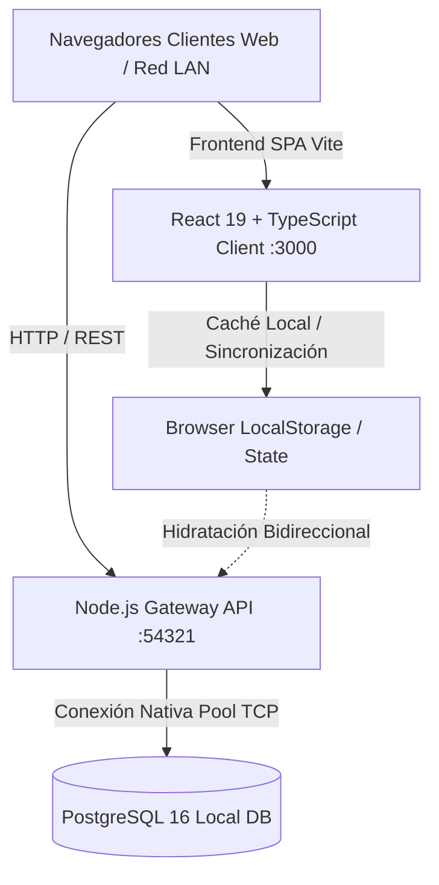

# SICE-CBA • Sistema Integral de Control y Evaluación
### U.E.P. Colegio Bellas Artes — Maracaibo, Zulia, Venezuela
**Código DEA:** S0432D2305 • **Año Escolar:** 2026 - 2027  
**Autor y Desarrollador Principal:** [Ing. en Informática Miguelangel Contreras Guillén](https://github.com/themiguedev)

[](https://github.com/themiguedev/SISCEBA/actions/workflows/deploy.yml)
[](https://nodejs.org/)
[](https://react.dev/)
[](https://www.typescriptlang.org/)
[](https://tailwindcss.com/)
[](https://www.postgresql.org/)

---

## 📖 Descripción General

**SICE-CBA (SISCEBA)** es la plataforma tecnológica integral diseñada y desarrollada a la medida para modernizar, unificar y sustituir de forma definitiva el sistema heredado **C.E.O. (Control de Estudios Online)** de la **U.E.P. Colegio Bellas Artes**.

El sistema cubre de punta a punta la gestión académica, control disciplinario, secretaría escolar, planificación didáctica docente, evaluación según las directrices oficiales del Ministerio del Poder Popular para la Educación (MPPE), emisión de formatos de impresión de alta fidelidad, reportes gerenciales y comunicación escolar omnicanal.

---

## 🏛️ Identidad Visual y Experiencia de Usuario (UI/UX)

* **Paleta Institucional CBA**:
  * **Azul Noche CBA (Dominante):** `#0D0E1A` / `#151628` / `#242646`
  * **Dorado Bellas Artes (Acento / CTA):** `#D4AF37` / `#F3E5AB` / `#A37F08`
  * **Borgoña Tradición:** `#800020`
* **Tipografía Oficial:** *Plus Jakarta Sans*
* **Doble Modo de Interfaz:**
  1. **✨ Modo Vanguardista 2026:** Arquitectura ejecutiva basada en tarjetas Bento, efectos glassmorphism, barra de comandos global (`Ctrl + K`), accesos rápidos de teclado y analítica visual en tiempo real.
  2. **🏛️ Modo Clásico:** Navegación tabular horizontal orientada a máxima familiaridad para usuarios en transición desde sistemas legados.
* **Formatos de Impresión Fieles (`@media print`):** Diseñados con estándares tipográficos milimétricos para la emisión física de boletines, actas de consejo, pases de retraso y constancias oficiales.

---

## 🏗️ Arquitectura Técnica y Persistencia

El sistema está concebido bajo una arquitectura resiliente, privada e independiente de servicios en la nube de terceros:



- **Base de Datos Unificada Nativa:** Instancia de PostgreSQL 16 local con servicio API REST nativo en Node.js (puerto `54321`). Prohibida la dependencia obligatoria de nubes propietarias externas (cero Supabase en producción).
- **Acceso Híbrido Concurrente:** Soporta simultáneamente accesos en el equipo local (`http://localhost:3000`) y a través de la Red LAN Institucional (`http://172.16.7.81:3000/SISCEBA/`) conectados a la misma base de datos relacional en tiempo real.
- **Auditoría e Integridad Referencial:** Registro detallado de transacciones, descargas de reportes, pases de retraso y modificaciones de notas con preservación de claves foráneas y restricciones lógicas.

---

## 👥 Modelo de Control de Acceso Basado en Roles (RBAC)

SICE-CBA implementa un sistema riguroso de permisos y visibilidad segmentado en 7 roles institucionales:

| Rol | Identificador | Alcance y Permisos Principales |
|---|---|---|
| **Administrador** | `ADMINISTRADOR` | Acceso global total. Control exclusivo del submódulo de **Matrícula y Prosecución**, Gestión de Usuarios, Códigos de Autorización y Configuración de Sistema. |
| **Director** | `DIRECTOR` | Supervisión académica, aprobación de planes, auditoría de reportes gerenciales, emisión de títulos y actas de consejo. |
| **Coordinación** | `COORDINACION` | Seguimiento pedagógico por subsistema (Inicial, Primaria, Media), revisión de planes quincenales y monitoreo de calificaciones. |
| **Secretaría** | `SECRETARIA` | Control de Inasistencias, Pases de Retraso, Expedientes de Conducta/Disciplina, gestión de trámites documentales y emisión de constancias (sin acceso a carga de notas ni matrícula). |
| **Docente** | `DOCENTE` | Gestión de bancos de competencias, diseño de planes quincenales/lapsos, registro de calificaciones por subsistema y asistencia de aula. |
| **Representante** | `REPRESENTANTE` | Consulta de boletines oficiales, seguimiento de inasistencias, solicitud de trámites de secretaría y cartelera comunitaria. |
| **Estudiante** | `ESTUDIANTE` | Consulta de evaluaciones, cronograma de actividades, cartelera escolar y recursos pedagógicos. |

---

## 📐 Reglas de Negocio Institucionales

### 1. Escalas Evaluativas Oficiales por Subsistema
El sistema aplica automáticamente los estándares de evaluación vigentes del MPPE y el reglamento interno del Colegio Bellas Artes:
* **Educación Inicial**: Escala exclusivamente **Literal** (`A`, `B`, `C`, `D`, `E`). No se promedian valores numéricos.
* **Educación Primaria**: Escala **Cualitativa / Formativa** basada en niveles de avance:
  * `L`: Logrado
  * `P` / `EP`: En Proceso
  * `I`: Iniciado
* **Educación Media General**: Escala **Cuantitativa Vigesimal** (`01` al `20`), con cálculo de ponderaciones por corte, notas de lapso y promedios definitivos.

### 2. Estructura Oficial de Secciones
* En todos los niveles y grados de Educación Inicial, Primaria y Media General, existen de forma estricta y exclusiva dos secciones: **Sección `A`** y **Sección `B`**.

### 3. Matrícula y Prosecución Escolar
* La promoción, asignación de cursos y prosecución de estudiantes es una prerrogativa restringida exclusivamente al perfil del **Administrador del Sistema**.

---

## 🧩 Módulos del Sistema

### 1. 📊 Escritorio y Telemetría Ejecutiva (`ESCRITORIO`)
* Resumen en vivo de matrícula activa, asistencia global del día, solicitudes en trámite y pases activos.
* Calendario dinámico de efemérides institucionales y nacionales del mes en curso.
* Gráficos interactivos de distribución de rendimiento y alertas de bajo promedio.

### 2. 📋 Gestión Escolar y Control de Estudios (`GESTION`)
* **Pases de Retraso y Portería:** Registro inmediato de tardanzas con emisión de boleta para ingreso a aula.
* **Conductas y Convivencia:** Expediente de incidencias leves, moderadas o graves, citaciones y acuerdos disciplinarios.
* **Trámites y Documentos (SLA):** Control de solicitudes de constancias de estudio, notas certificadas y cartas de buena conducta con semáforo de vencimiento.
* **Control de Inasistencias:** Módulo de justificaciones y registro por asignatura.
* **Matrícula y Prosecución:** Asignación de cupos, balance de secciones A/B y pases de año escolar.
* **Gestión de Usuarios y Accesos:** Creación de usuarios del personal, restablecimiento de contraseñas y emisión de Códigos de Autorización para auto-registro seguro.
* **Bloqueos Administrativos:** Gestión de solvencias administrativas y cobranzas.
* **Talleres CRP:** Asignación de estudiantes a cursos de Creación, Recreación y Producción.
* **Títulos de Bachiller:** Verificación de seriales de títulos, calibración de notas y preparación de documentos ministeriales.
* **Tareas Recurrentes de Control de Estudios:**
  * Auditoría de ponderaciones de evaluación departamentales.
  * Corrector ortográfico y normalizador de indicadores pedagógicos.
  * Evaluador de fluidez y comprensión de lectoescritura.
  * Generador y corrector masivo de observaciones para boletines.
  * Sábana global de notas y verificación integral de pensum.

### 3. 📝 Planificación Pedagógica (`PLANIFICACION`)
* **Bancos de Recursos Didácticos:** Competencias por área, indicadores de logro con ponderación y estrategias didácticas con opción de transferencia inter-periodos.
* **Diseñador de Plan Quincenal:** Interfaz paso a paso con asignación de recursos, fechas e instrumentos de evaluación.
* **Planes de Lapso:** Estructuración trimestral del plan curricular.
* **Integración Google Classroom:** Herramientas de sincronización y exportación de actividades pedagógicas.

### 4. 🎯 Evaluación Integral (`EVALUACION`)
* Registro de notas adaptativo según el nivel formativo del estudiante.
* Módulo especializado de Evaluación Diagnóstica y Robótica Educativa.
* Publicación formal de calificaciones, generación de cortes de lapso y cuadro de honor institucional.

### 5. 🖨️ Catálogo Oficial de Reportes y Consultas (`CONSULTAS`)
* **Catálogo de 89 Reportes Oficiales C.E.O.** completamente homologados con filtros 1:1.
* Reporte especializado de **Literales por Sección** y **Literales por Rango**.
* Boletines Informativos Oficiales listos para entrega con membrete institucional.
* Actas de Consejo de Docentes con cómputo de quórum y firmas de rigor.
* Auditoría completa de descargas de reportes por usuario y fecha.

### 6. 🌐 Comunidad y Comunicación (`COMUNIDAD`)
* Cartelera informativa institucional con comunicados segmentados.
* Foros de consulta y canales de interacción para la comunidad Bellas Artes.
* Centro de Notificaciones en tiempo real para eventos de sistema.

### 7. ⚙️ Configuración y Ayuda (`CONFIGURACION` / `AYUDA`)
* Ajustes del año lectivo, cortes de lapsos, parámetros de evaluación y reglas institucionales.
* Manual de Usuario Interactivo con guías especializadas para cada rol institucional.

---

## 🛠️ Herramientas de Mantenimiento y CLI (`tools/`)

El proyecto incluye un conjunto de utilidades en Node.js para administración y sincronización:

| Script | Propósito |
|---|---|
| `npm run db:init` | Inicializa la estructura del esquema y tablas en PostgreSQL local. |
| `npm run db:start` | Levanta el demonio del servicio Gateway API de la base de datos local. |
| `npm run db:stop` | Detiene el servicio Gateway local de forma controlada. |
| `npm run test:stress` | Ejecuta pruebas de concurrencia y estrés sobre la base de datos. |
| `node tools/sync-student-users.mjs` | Genera y sincroniza automáticamente las cuentas de usuario para el padrón de estudiantes. |
| `node tools/sync-representative-users.mjs` | Genera y vincula las cuentas para los representantes legales. |
| `node tools/sync-seed-students.mjs` | Actualiza la nómina de estudiantes en la semilla SQL y TypeScript. |

---

## 🚀 Instalación y Puesta en Marcha

### Prerrequisitos
* **Node.js**: v18.0.0 o superior
* **PostgreSQL**: v16.x instalado y configurado localmente
* **Git**: Para control de versiones

### Pasos de Ejecución

```bash
# 1. Clonar el repositorio
git clone https://github.com/themiguedev/SISCEBA.git
cd SISCEBA

# 2. Instalar dependencias
npm install

# 3. Iniciar el entorno de datos local (PostgreSQL Gateway)
npm run db:start

# 4. Iniciar el servidor de desarrollo Vite
npm run dev
```

El aplicativo estará disponible en:
- Entorno local: `http://localhost:3000`
- Entorno de red local: `http://<IP-DE-TU-RED>:3000/SISCEBA/`

### Compilación para Producción

```bash
# Verificar tipos y compilar bundle optimizado
npm run build

# Previsualizar el build generado en dist/
npm run preview
```

---

## 📂 Presentación Ejecutiva y Comparativa (CBA vs C.E.O.)

El repositorio incluye la suite interactiva de presentación para juntas directivas y personal docente:
* **Archivo de Presentación:** [`presentacion_sisceba_vs_ceo.html`](file:///d:/Usuarios/UCE.FCBA/Documents/SIS-CBA/presentacion_sisceba_vs_ceo.html)
* **Acceso Rápido:** Abrir con cualquier navegador web o mediante el script lanzador `public/presentacion/INICIAR_PRESENTACION.bat`.
* Demuestra las ventajas competitivas de SICE-CBA: rendimiento instantáneo, diseño vanguardista, cumplimiento normativo MPPE y cero costos de alojamiento en servidores externos.

---

## 📜 Licencia y Derechos de Autor

**© 2026 - 2027 U.E.P. Colegio Bellas Artes — Maracaibo, Venezuela.**  
Desarrollado con dedicación y excelencia por el **Ing. en Informática Miguelangel Contreras Guillén**.  
*Todos los derechos reservados. Uso exclusivo institucional para la U.E.P. Colegio Bellas Artes.*
