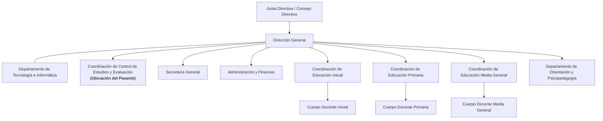

# CAPÍTULO I
# INFORMACIÓN GENERAL DE LA EMPRESA

El presente capítulo tiene como propósito fundamental suministrar una caracterización integral, histórica, axiológica y organizativa de la institución donde se ejecutó la práctica profesional. A través de este diagnóstico institucional, se contextualiza el entorno laboral en el cual se desarrolló el proyecto tecnológico, delimitando los orígenes y evolución de la entidad, sus postulados teleológicos de misión, visión y objetivos, la estructura jerárquico-organizacional que rige sus operaciones con énfasis exclusivo en el área de adscripción del pasante, y la correlación sustantiva entre las responsabilidades técnicas ejecutadas y las competencias profesionales del perfil de egreso en Ingeniería en Informática.

---

## 1.1 Antecedentes, Origen y Creación (Máximo tres páginas)

La trayectoria histórica de la **Unidad Educativa Privada Colegio Bellas Artes** se encuentra indisolublemente articulada a la historia cultural, pedagógica y cívica de la ciudad de Maracaibo y del Estado Zulia. Para comprender con rigurosidad sus orígenes institucionales, es necesario remitirse a la génesis cultural sembrada a mediados del siglo XX en la región. El **23 de marzo de 1953**, un ilustre grupo de promotoras sociales y figuras de la intelectualidad zuliana —entre ellas Mercedes Bermúdez de Belloso, Lía Bermúdez, Alfonsina de Castillo Plaza, Irma Barboza González y Rosario de Urdaneta— fundó en Maracaibo el **Centro de Bellas Artes (CBA)**, una asociación civil de vanguardia concebida para la difusión, preservación y florecimiento de las artes plásticas, escénicas y musicales.

Inspirados en ese fértil horizonte humanístico y con la firme convicción de que el verdadero cultivo del espíritu y el intelecto humano debía forjarse sistemáticamente desde la infancia, un distinguido grupo de educadores y visionarios materializó la creación de la institución escolar formal. De esta manera, el **Colegio Bellas Artes fue fundado oficialmente el 16 de septiembre de 1975** por **José Antonio Hands, Augusta Faría, Oscar d'Empaire y Ender Rincón** en la ciudad de Maracaibo, Estado Zulia.

La institución nació con un propósito fundacional claro y trascendente: constituirse como una **institución educativa de excelencia con un enfoque integral centrado en el desarrollo armónico de talentos artísticos, científicos y humanísticos**. Establecido en su sede campestre y moderna situada en la **Avenida 3F con calle 71**, en la parroquia Olegario Villalobos de Maracaibo, el plantel inició sus labores pedagógicas integrando la formación académica formal con la sensibilización artística, los idiomas y los valores cívicos, erigiéndose con rapidez como un centro educativo de vanguardia y referente de calidad en todo el occidente venezolano.

Durante las décadas posteriores, la institución experimentó un proceso de maduración y consolidación estructural sistemático. Para dar respuesta a la creciente demanda formativa de las familias zulianas, el Colegio Bellas Artes diseñó e implementó de manera progresiva una estructura educativa adaptada a las directrices de los programas curriculares oficiales, organizada en tres subsistemas fundamentales:
1. **Educación Inicial:** Concebida como la etapa fundacional de aprestamiento, desarrollo psicomotor, afectivo y social, integrando componentes ambientales, formación personal y áreas creativas como artes plásticas, iniciación musical, ajedrez formativo, natación, robótica lúdica e inmersión en una segunda lengua.
2. **Educación Primaria:** Diseñada para cimentar el dominio del lenguaje, la comprensión lectora, el razonamiento lógico-matemático, la indagación en ciencias naturales y sociales, y habilidades del siglo XXI como finanzas básicas, diseño creativo, robótica y tecnología aplicada, preservando la formación deportiva y estética como ejes curriculares integrados.
3. **Educación Media General:** Estructurada bajo un enfoque científico-humanístico de alto rendimiento y pensamiento crítico, orientada a dotar a los jóvenes de competencias investigativas, informáticas, de inteligencia artificial básica, proyectos de vida e idiomas, preparándolos exitosamente para su inserción en la educación universitaria nacional e internacional.

Un rasgo definitorio y principio rector de la organización académica del Colegio Bellas Artes ha sido el mantenimiento de una rigurosa política de matrícula controlada. En todos los grados y años de escolaridad de sus tres subsistemas, la institución opera **exclusivamente con dos secciones oficiales: Sección "A" y Sección "B"**. Esta disposición asegura una atención personalizada de alta fidelidad pedagógica, una estrecha correlación entre el docente y el estudiante, y un control exhaustivo del rendimiento y bienestar de cada alumno, preservando los estándares de excelencia educativa que le han caracterizado por más de siete décadas.

En el plano contemporáneo, la U.E.P. Colegio Bellas Artes ha asumido de forma decidida los retos de la era digital y la transformación tecnológica. Históricamente, los procesos de registro de calificaciones, control de asistencia, planificación docente y emisión de boletines dependían de formularios físicos y libros de vida manuscritos, esquema que posteriormente transitó hacia sistemas digitales de terceros basados en la nube, tales como el software comercial C.E.O. (Control Estudiantil Online de Lidsoftware). No obstante, la dependencia de servidores externos, la rigidez funcional ante las reformas curriculares internas, la exposición de datos sensibles y las contingencias asociadas a la conectividad nacional plantearon la urgencia de alcanzar una verdadera **autonomía y soberanía tecnológica**.

Frente a esta coyuntura institucional, en el marco del periodo escolar 2026-2027, la Dirección General y la Coordinación de Control de Estudios impulsaron la modernización integral de sus plataformas operativas. Se encomendó al Departamento de Tecnología e Informática el análisis, diseño, desarrollo e implantación local del **Sistema Integral de Control y Evaluación (SICE-CBA)**. Desarrollado de forma nativa por el pasante e Ingeniero en Informática Miguelangel Contreras Guillén, el sistema SICE-CBA consolida una arquitectura moderna, segura y de alta disponibilidad desplegada en red de área local (LAN) y respaldada por un motor de base de datos relacional PostgreSQL 16. La plataforma automatiza de extremo a extremo la planificación pedagógica quincenal y de lapso, los registros evaluativos diagnósticos, procesales y sumativos según las particularidades de cada subsistema (escalas cualitativas, cuantitativas y literales), el control biométrico y de pases de retraso, y la emisión en alta fidelidad de boletines informativos y actas oficiales de consejo de curso.

Hoy en día, la U.E.P. Colegio Bellas Artes se erige como un referente de tradición viva, excelencia académica y modernidad tecnológica en el Estado Zulia, conservando incólume el legado ético de sus fundadoras y adaptando continuamente sus procesos de gestión para brindar a su comunidad una formación de calidad superior con herramientas del futuro.

---

## 1.2 Misión, Visión y Objetivos

Los pilares teleológicos y la orientación estratégica que guían el funcionamiento integral de la institución se encuentran formalizados en sus principios institucionales:

### 1.2.1 Misión
> "Formar ciudadanas y ciudadanos integrales, proactivos, reflexivos y autónomos, dotados de sólidos principios éticos, morales y cívicos, mediante un proceso pedagógico de excelencia que articula armónicamente el rigor académico, el pensamiento científico, la innovación tecnológica y la sensibilidad artística, preparándolos para responder de forma asertiva, crítica y comprometida a los desafíos del entorno social, regional y global."

### 1.2.2 Visión
> "Consolidarse como la institución educativa de referencia y vanguardia en el occidente venezolano, reconocida nacional e internacionalmente por su excelencia pedagógica, su liderazgo en innovación curricular y tecnológica, y su capacidad demostrada de egresar ciudadanas y ciudadanos líderes con profunda sensibilidad humanista, comprometidos con el desarrollo integral sostenible de la sociedad."

### 1.2.3 Objetivos

#### Objetivo General
Proporcionar una educación integral, personalizada y de máxima calidad pedagógica en los subsistemas de Educación Inicial, Educación Primaria y Educación Media General, que propicie en los educandos el pensamiento analítico, la consolidación de valores éticos universales y el dominio de competencias científicas, tecnológicas, deportivas y artísticas indispensables para su desarrollo vital.

#### Objetivos Específicos
* Desarrollar en los estudiantes competencias cognitivas, comunicativas, procedimentales y socioemocionales de alto nivel, fundamentadas en metodologías de enseñanza activas, reflexivas y constructivistas.
* Promover la sensibilidad estética, el aprecio por las bellas artes, la práctica sistemática deportiva y la conciencia ecológica como ejes formativos transversales del perfil estudiantil.
* Incorporar herramientas informáticas de vanguardia, robótica educativa y plataformas digitales de desarrollo propio en los procesos académicos, pedagógicos y administrativos de la institución.
* Ejecutar sistemas de evaluación integral continua, formativa y multidimensional que respeten las especificidades pedagógicas, cualitativas y cuantitativas de cada nivel educativo.
* Fomentar la corresponsabilidad activa, la comunicación transparente y la integración colaborativa entre la familia, la escuela y la comunidad para el acompañamiento permanente del estudiante.

---

## 1.3 Estructura Organizacional

La estructura organizativa de la U.E.P. Colegio Bellas Artes está fundamentada en un diseño funcional, matricial y jerárquico que asegura la articulación armónica entre las instancias de gobierno y dirección general, los órganos de coordinación académica y pedagógica, y las unidades de apoyo técnico, administrativo y tecnológico.

### Organigrama General de la Institución

### Caracterización del Departamento donde se Realizan las Pasantías

En estricta concordancia con la pauta metodológica institucional, a continuación se describe de manera puntual y exclusiva la unidad operativa donde estuvo adscrito el pasante durante el desarrollo de su práctica profesional:

#### Denominación y Nivel Jerárquico
* **Denominación del Área:** Coordinación de Control de Estudios y Evaluación.
* **Ubicación en la Estructura Organizativa:** Dependencia técnica, académica y operativa de primer nivel adscrita directamente a la **Dirección General**, con articulación transversal y permanente sobre las **Coordinaciones de Educación Inicial, Primaria y Media General**, la **Secretaría General** y el cuerpo docente institucional.

#### Misión del Área
Planificar, dirigir, supervisar, validar y certificar los procesos de registro académico, prosecución escolar, régimen de evaluación de los aprendizajes y expedición de documentos probatorios oficiales de estudio en los tres subsistemas escolares de la U.E.P. Colegio Bellas Artes, garantizando la legalidad, transparencia, rigurosidad técnica y optimización operativa de la gestión escolar mediante la implantación de plataformas tecnológicas de vanguardia.

#### Funciones Principales de la Coordinación
1. **Administración y Supervisión del Régimen de Evaluación:** Coordinar, verificar y estandarizar la aplicación de las normativas de evaluación emanadas del Ministerio del Poder Popular para la Educación (MPPE) y los reglamentos institucionales, adaptadas a las particularidades pedagógicas de cada subsistema (escala literal en Educación Inicial, escala cualitativa formativa en Educación Primaria y escala cuantitativa vigesimal en Educación Media General).
2. **Procesamiento, Auditoría y Certificación de Calificaciones:** Centralizar y auditar la carga procesal y definitiva de notas, validar las deliberaciones y actas de los consejos de curso, consolidar los promedios estudiantiles y autorizar la emisión de boletines informativos oficiales de evaluación.
3. **Gestión de Matrícula, Padrón Estudiantil y Prosecución:** Coordinar los flujos de inscripción, asignación de estudiantes a las dos únicas secciones oficiales por grado/año (**Secciones A y B**), control de asistencia, seguimiento a pases de retraso y resguardo del expediente pedagógico acumulativo del estudiante.
4. **Automatización y Modernización de los Procesos de Control Escolar:** Planificar, estructurar, parametrizar e implantar la plataforma de software institucional **SICE-CBA** (Sistema Integral de Control y Evaluación), migrando la gestión de datos académicos desde mecanismos físicos o plataformas externas hacia una arquitectura computacional interna, segura y autónoma.
5. **Emisión de Documentos y Salvaguarda del Archivo Académico:** Gestionar la emisión oportuna de certificaciones de calificaciones, constancias de estudio, títulos, actas oficiales y trámites ante la Zona Educativa, custodiando los archivos históricos tanto en formato físico como en bases de datos digitales con rigurosos criterios de confidencialidad e integridad.

---

## 1.4 Relación entre las funciones del área en el cual se realiza las pasantías y el perfil del egresado

Con el propósito de validar la pertinencia académica, la coherencia curricular y la aplicabilidad de los conocimientos teóricos y técnicos desarrollados a lo largo del plan de estudios de la carrera de Ingeniería en Informática de la Universidad Privada Dr. Rafael Belloso Chacín (URBE), se procede a confrontar las responsabilidades asumidas en la Coordinación de Control de Estudios y Evaluación con las competencias constitutivas del perfil profesional del egresado.

### Cuadro 1: Relación entre las Funciones del Área y Perfil del Egresado

| Funciones del área donde se realizan las pasantías | Perfil profesional del pasante (Ingeniero en Informática - URBE) |
| :--- | :--- |
| **1. Automatización Integral del Control Escolar y Evaluación (SICE-CBA):** Relevamiento de normativas curriculares, diseño modular de la arquitectura del software, codificación de componentes en React/TypeScript y parametrización de las escalas de evaluación específicas de Inicial, Primaria y Media General. | **Diseño e Implantación de Sistemas Automatizados:** Competencia fundamental para diagnosticar requerimientos de información, concebir arquitecturas lógicas eficientes y programar sistemas de información robustos que resuelvan problemas operativos complejos con altos estándares de calidad. |
| **2. Administración, Normalización y Auditoría de Datos Académicos:** Modelado de esquemas relacionales, integridad referencial de llaves foráneas, optimización de consultas SQL y resguardo de la persistencia de notas y matrículas en el motor de base de datos PostgreSQL 16 sobre la red institucional. | **Gestión de Datos y Arquitecturas de Información:** Habilidad técnica para modelar, estructurar, operar y auditar sistemas de bases de datos relacionales, garantizando la consistencia, disponibilidad, resiliencia y oportunidad de los datos que sustentan las operaciones del plantel. |
| **3. Consolidación Estadística y Soporte a la Toma de Decisiones:** Codificación de motores de cálculo de notas, ponderaciones por lapso, estadísticas de consolidación de indicadores y generación automatizada de boletines oficiales, actas de consejo de curso e informes de rendimiento. | **Optimización y Soporte a la Toma de Decisiones:** Capacidad para estructurar flujos de datos complejos, facilitando la toma de decisiones oportunas y estratégicas en los niveles directivos, tácticos y de coordinación mediante métricas e indicadores de rendimiento confiables. |
| **4. Seguridad de la Información, Privacidad y Control de Acceso (RBAC):** Configuración de políticas de seguridad lógica y privilegios estrictos para Administrador, Director, Coordinación, Secretaria, Docente y Estudiante, blindando los expedientes escolares frente a accesos no autorizados. | **Seguridad Informática y Gobernanza de TI:** Destreza para aplicar normativas de confidencialidad, controles de acceso por roles, validación de sesiones y salvaguarda de activos tecnológicos, previniendo alteraciones ilegítimas de notas y filtraciones de información confidencial. |
| **5. Estandarización de Flujos Operativos y Soporte al Personal:** Elaboración de manuales técnicos y de usuario, capacitación al personal directivo y docente en el uso de los módulos evaluativos y asesoría técnica en la resolución de incidencias en el registro de calificaciones. | **Liderazgo, Transferencia Tecnológica y Comunicación Asertiva:** Aptitud para interactuar efectivamente con equipos interdisciplinarios, diagnosticar necesidades de los usuarios, comunicar soluciones de ingeniería de forma comprensible y liderar procesos de adopción tecnológica exitosos. |
| **Análisis** | |
| Al efectuar un análisis comparativo y crítico entre las actividades desempeñadas en la Coordinación de Control de Estudios y Evaluación del Colegio Bellas Artes y el perfil profesional del egresado en Ingeniería en Informática de la URBE, se comprueba una **estricta coherencia, pertinencia y aplicabilidad práctica**. Históricamente, las áreas de control de estudios han dependido de procesos manuales intensivos o de software rígido de terceros; la incorporación del pasante como ingeniero de software permitió transformar radicalmente la unidad, digitalizando el ciclo evaluativo y dotando a la institución de soberanía tecnológica mediante el desarrollo del sistema SICE-CBA. Las responsabilidades asumidas demandaron la aplicación directa de disciplinas clave como la Ingeniería de Software, Bases de Datos, Seguridad Lógica y Redes, evidenciando que el perfil del egresado de URBE capacita al estudiante para desempeñarse con solvencia como líder de proyectos tecnológicos y agente de modernización institucional. | |

**Fuente:** González (2020), adaptado al área de práctica profesional en la U.E.P. Colegio Bellas Artes (2026).

---

### Análisis Cualitativo de Coherencia y Pertinencia Curricular

El perfil del Ingeniero en Informática de la URBE enfatiza la formación de profesionales capaces de liderar la transformación digital, diseñar soluciones informáticas integrales y apoyar la toma de decisiones en entornos complejos. 

En la práctica profesional realizada en la **Coordinación de Control de Estudios y Evaluación** del Colegio Bellas Artes, dicha premisa formativa se materializó de manera integral a través del proyecto **SICE-CBA**, en virtud de los siguientes aspectos:
1. **Pertinencia Técnica y Metodológica:** El pasante aplicó metodologías de desarrollo ágil y principios rigurosos de ingeniería de software (modularidad, separación de responsabilidades, control de versiones con Git, tipado estático riguroso y arquitectura basada en componentes), garantizando que el producto final fuera mantenible y escalable en el tiempo.
2. **Soberanía y Seguridad de Datos Académicos:** Al eliminar la dependencia de servidores externos y proveedores de software por suscripción, el pasante implementó una solución en red local privada con PostgreSQL 16, aplicando las directrices de seguridad de la información aprendidas en la carrera para resguardar la privacidad y los derechos de los niños, niñas y adolescentes de la institución.
3. **Impacto Institucional Directo:** La automatización de los procesos de carga de notas, boletines informativos e indicadores pedagógicos redujo sustancialmente el margen de error humano y los tiempos de procesamiento administrativo, dotando a la Coordinación y a la Dirección General de tableros de control y analíticas en tiempo real.

En conclusión, se evidencia que existe una correspondencia perfecta entre los requerimientos laborales del área de Control de Estudios y Evaluación y las competencias desarrolladas por el egresado, ratificando la solvencia académica y profesional del pasante para actuar como un ingeniero proyectista y transformador de procesos organizacionales.
